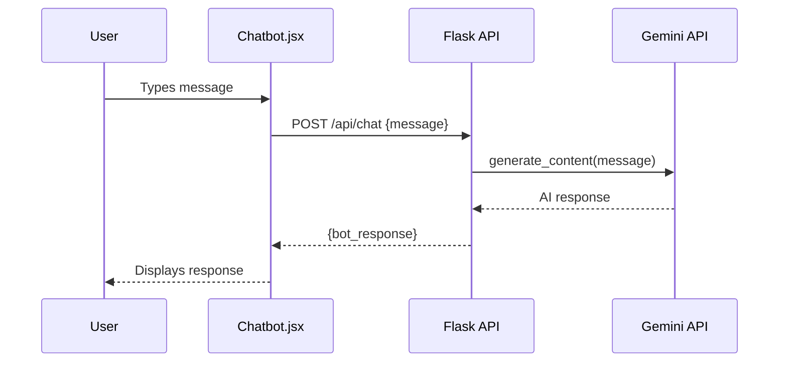

# 🤖 Gemini API → EcoBot Integration Plan

## Current State

| Component | Status | Details |
|-----------|--------|---------|
| **`.env` file** | ✅ Exists | Has `GEMINI_API_KEY` in [`DT1/.env`](file:///c:/Users/HP/Downloads/DTFinalproject/DT1/.env) |
| **Backend `/api/chat` route** | ✅ Exists | [`app.py` L78-96](file:///c:/Users/HP/Downloads/DTFinalproject/DT1/backend/app.py#L78-L96) — already calls Gemini |
| **Frontend `Chatbot.jsx`** | ❌ Not connected | [`Chatbot.jsx`](file:///c:/Users/HP/Downloads/DTFinalproject/DT1/frontend/src/components/Chatbot.jsx) uses **hardcoded fake replies** instead of calling the backend API |

## What Needs to Change (Only 2 Steps!)

### Step 1: Update your Gemini API key in `.env`
Replace the existing key with your newly generated one:
```
GEMINI_API_KEY=your_new_key_here
```

### Step 2: Connect `Chatbot.jsx` to the backend API
Currently, the chatbot uses a `setTimeout` with hardcoded replies (lines 20-26). 
We need to replace that with an `axios.post` call to `http://localhost:5000/api/chat`.

**Changes:**
- Add `axios` import  
- Replace the fake `setTimeout` reply with a real API call
- Add a "thinking" indicator while waiting for Gemini's response
- Add an eco-focused system prompt so Gemini responds as an environmental expert

### Step 3 (Optional): Upgrade to `google.genai`
The current backend uses the deprecated `google.generativeai` package. Google recommends switching to `google.genai`. This works for now but should be migrated eventually.

---

## Flow After Integration



> [!IMPORTANT]
> **Only 2 files need changes:** `.env` (paste your key) and `Chatbot.jsx` (connect to API). The backend is already ready!
